

# BlogCabin 블로그캐빈

**글을 쓸수록 내 마을이 자라는 게임형 블로그**

블로그들이 모여 사는 오두막 마을. 글을 쓰고, 이웃과 놀고, 캐릭터와 집을 꾸며요.

[바로 써 보기](https://blogcabin.java21.net) · [소스코드](https://github.com/cabinlog1070/blogcabin) · [설계 문서](https://github.com/cabinlog1070/docs)

  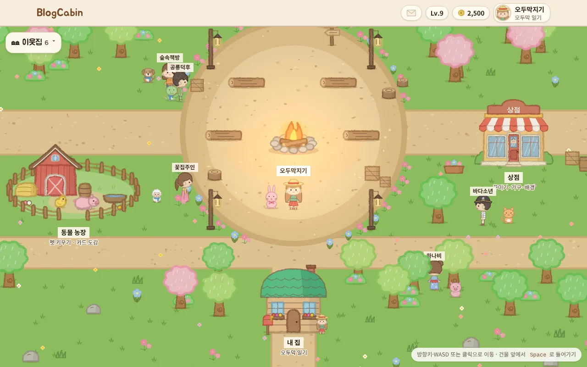

로그인하면 **광장**에 도착해요. 캠프파이어를 가운데 두고 상점, 동물 농장, 마을 게시판, 내 집이 모여 있고, 즐겨찾기한 이웃들이 펫과 함께 걸어 다녀요. 내 집 문으로 들어가면 내 블로그예요. 그림은 모두 코드로 그린 **파스텔 크레용** 그림체이고, 화면은 **한국어와 일본어**로 볼 수 있어요.

## 목차

- [한눈에 보기](#한눈에-보기)
- [빠르게 시작하기](#빠르게-시작하기)
- [주요 기능](#주요-기능)
- [구조](#구조)
- [저장소](#저장소)
- [기술 스택](#기술-스택)
- [개발 방식](#개발-방식)
- [릴리스](#릴리스)

## 한눈에 보기

| | BlogCabin |
| --- | --- |
| 무엇 | 티스토리 같은 블로그 + 작은 마을 게임. 글을 쓰고 출석하면 경험치와 코인이 쌓여요 |
| 블로그 | 내 주소(`/@주소`), 글쓰기 에디터, 사진·파일 첨부, 표, 사진 슬라이드, 카테고리·태그, 예약 발행, 번역 버튼 |
| 광장 | 2D 마을을 걷고 건물에 들어가기, 이웃 산책·말풍선, 저녁 반딧불이와 불꽃놀이, 휴대폰 조이스틱 |
| 꾸미기 | 헤어·모자·상의·하의·신발, 머리 색, 미니룸 가구 끌어다 놓기, 집 지붕 색 |
| 동물 농장 | 알 부화, 펫 19종 키우기, 펫 꾸미기, 카드 도감, 펫과 함께 광장 산책 |
| 교류 | 공감, 댓글·답글, 이웃(서로 이웃·즐겨찾기), 마을 소식, 친구 초대 보상 |
| 운영 | main에 합치면 GitHub Actions가 Docker 이미지를 만들어 서버에 **끊김 없이(롤링)** 배포 |

## 빠르게 시작하기

1. https://blogcabin.java21.net 에서 **회원가입** (아이디·비밀번호, 또는 카카오·네이버·구글)
2. 닉네임과 블로그 주소를 정하고 캐릭터(짧은 머리 / 긴 머리)를 고르면 광장에 도착해요
3. **내 집**에 들어가 ✏️ 글쓰기. 글을 쓰면 경험치와 코인을 받아요
4. 코인으로 **상점**에서 옷·가구·배경을 사고, **동물 농장**에서 첫 알을 받아 보세요

## 주요 기능

<table>
<tr>
<td width="50%">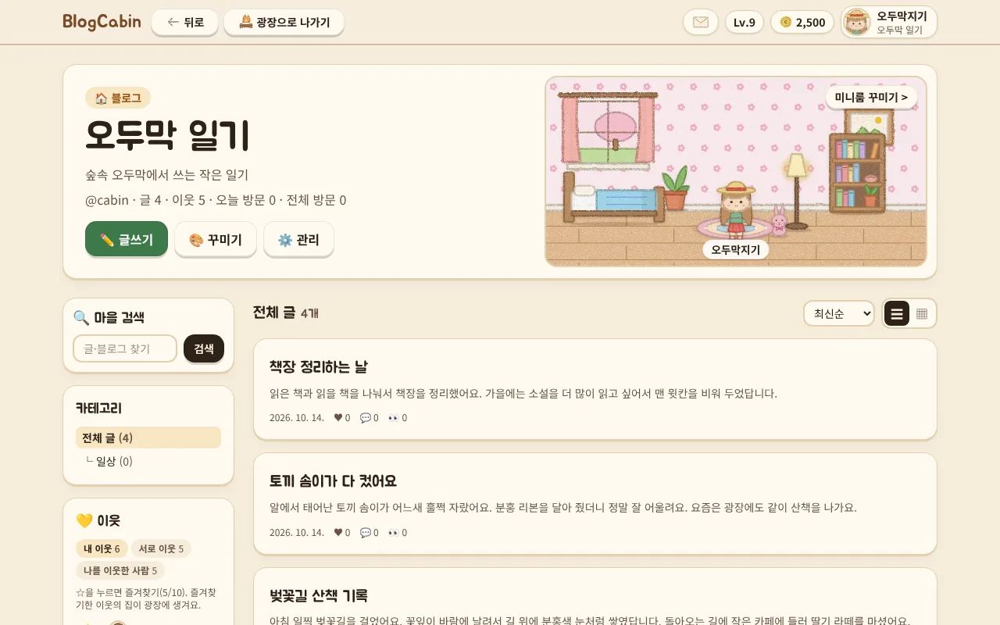 <b>블로그 홈</b> · 미니룸, 카테고리, 이웃, 글 목록</td>
<td width="50%">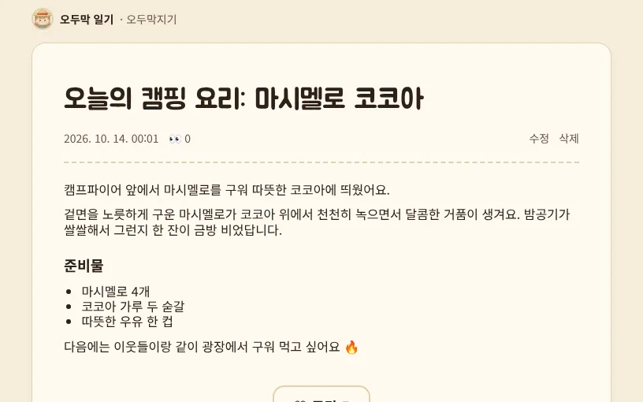 <b>글 읽기</b> · 공감, 댓글·답글, 이전/다음 글</td>
</tr>
<tr>
<td width="50%">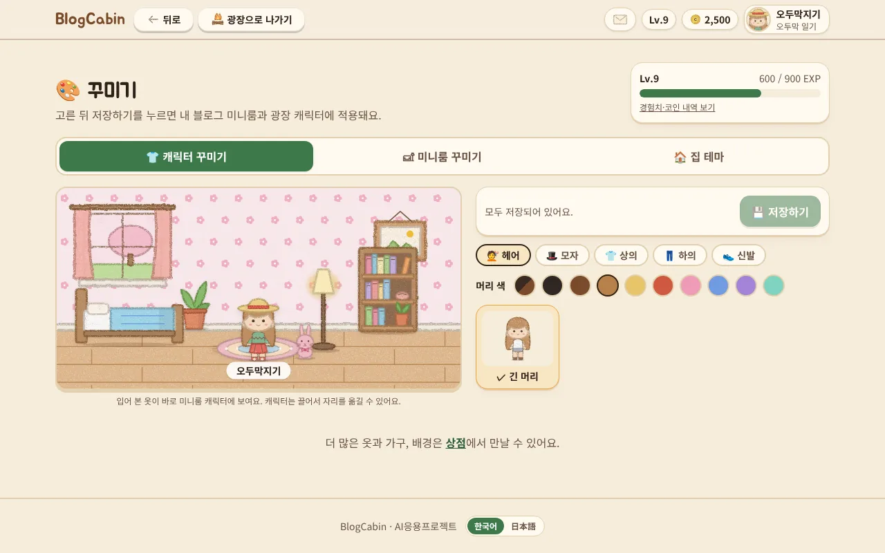 <b>꾸미기</b> · 입어 본 옷이 미니룸 캐릭터에 바로 보여요</td>
<td width="50%">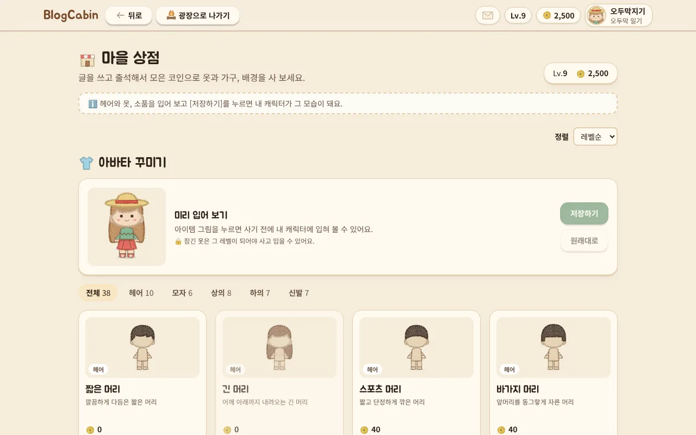 <b>마을 상점</b> · 사기 전에 미리 입어 보기</td>
</tr>
<tr>
<td width="50%">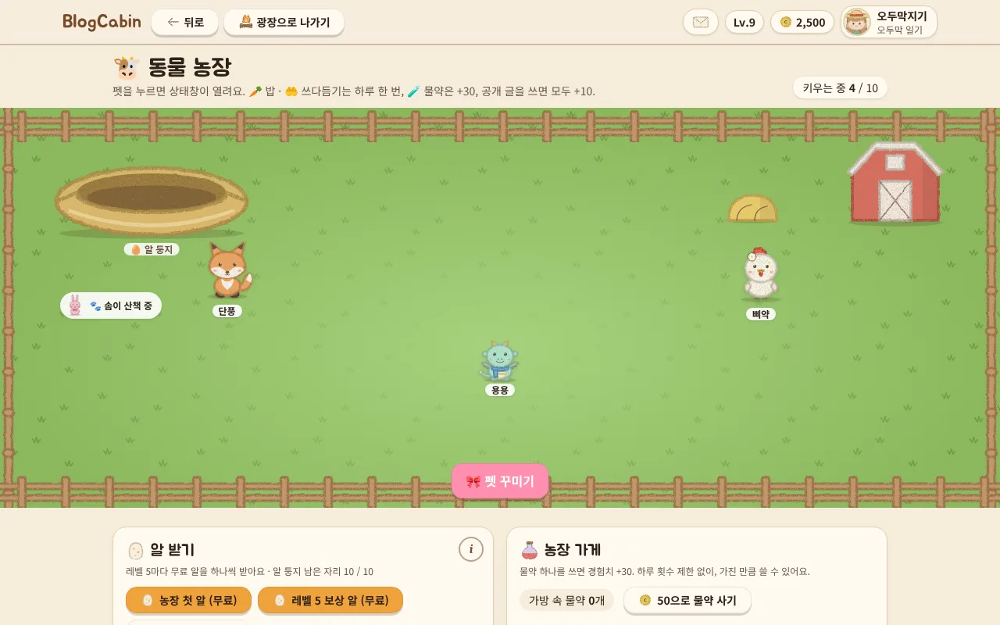 <b>동물 농장</b> · 알 둥지, 펫 돌보기, 펫 꾸미기</td>
<td width="50%">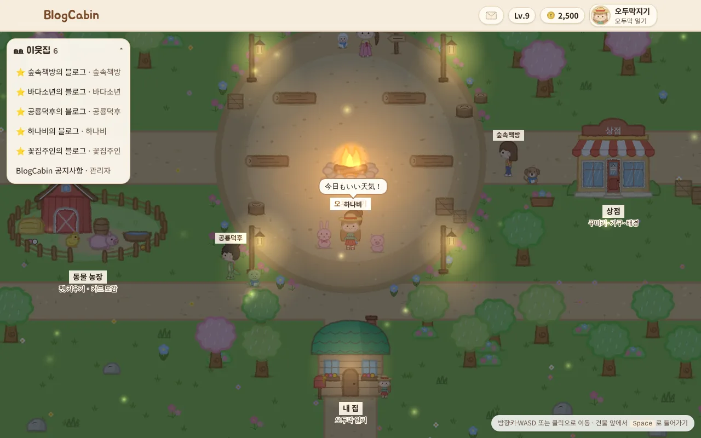 <b>이웃과 말풍선</b> · 가까이 가면 이웃의 상태 메시지가 떠요</td>
</tr>
</table>

  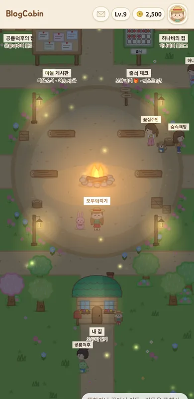
  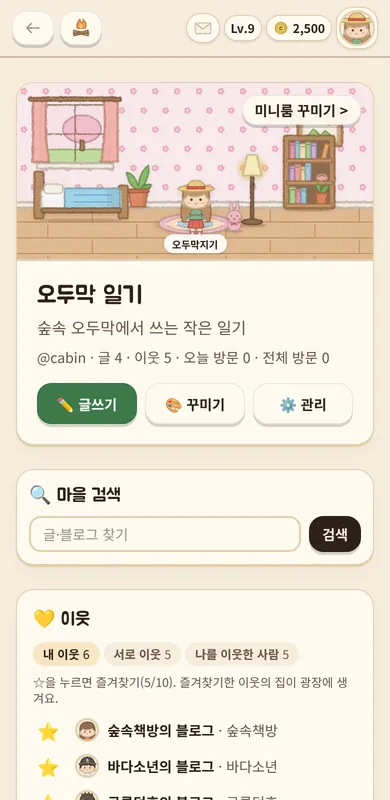
  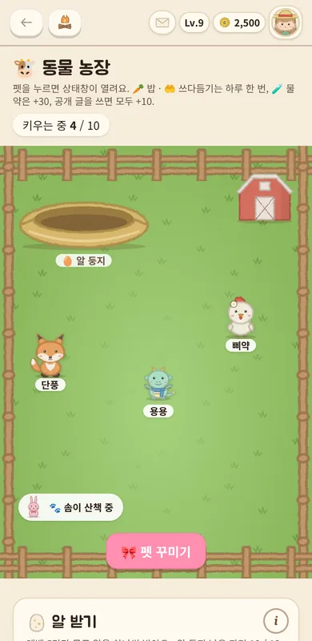
   휴대폰에서도 같은 마을 (탭하거나 끌어서 이동)

### 블로그

- **글쓰기 에디터** · 굵게·색·정렬·줄 간격, 표, 사진 슬라이드·나란히 놓기, 파일 첨부. 저장할 때 HTML을 정화해서 위험한 코드를 막아요
- **예약 발행** · 원하는 시간에 글이 올라가요
- **번역 버튼** · 다른 언어로 쓴 글을 읽는 사람이 눌러서 번역
- **블로그 홈** · 미니룸, 카테고리, 이웃 목록, 목록형·바둑판형 보기

### 마을과 게임

- **광장** · 방향키·WASD·클릭(휴대폰은 탭·조이스틱)으로 이동, 건물 앞에서 들어가기. 나갔다 오면 있던 자리에 그대로
- **이웃** · 즐겨찾기한 이웃은 광장을 돌아다니며 기타 치기, 마시멜로 굽기, 낚시 같은 행동을 해요
- **성장** · 출석(7일 연속 보너스), 글·댓글·공감 보상(하루 상한), 레벨이 오르면 집이 커져요(3단계)
- **꾸미기** · 상점에서 산 옷과 머리로 캐릭터 바꾸기, 가구 배치, 배경, 지붕 색
- **동물 농장** · 알이 부화하면 펫이 태어나고, 밥·쓰다듬기·물약으로 키워요. 다 키우면 카드 도감에 남아요
- **알림·릴리스 노트** · 공감·댓글·선물 알림, 내 정보 메뉴에서 버전별로 바뀐 점 보기

### 관리자

- 통계, 회원 목록, 글·댓글 관리, 코인·아이템·펫 알 선물, 공지사항 블로그

## 구조

BlogCabin은 **Next.js 앱 하나**가 화면과 서버 로직을 함께 맡아요. 프론트 서버와 API 서버를 따로 두지 않고, 글 저장·구매·출석 같은 일은 같은 앱의 Server Action이 처리해요. 광장 게임(Phaser)은 브라우저에서만 돌아요.

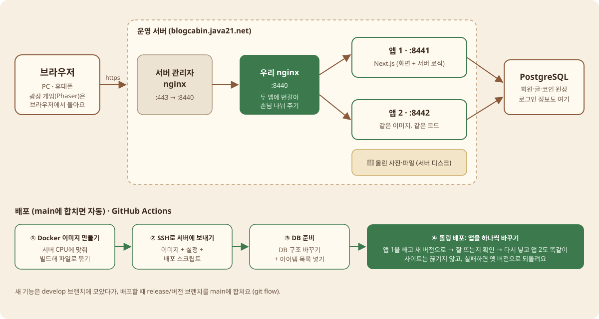

### 설계 포인트

- **잔액을 저장하지 않아요** · 코인·경험치는 `point_ledger`(원장)에 기록만 하고 합계로 계산해요. 레벨도 경험치에서 계산해요
- **규칙은 DB가 지켜요** · 출석은 하루 한 번(기본 키), 공감은 글마다 한 번(유니크), 장착은 가진 아이템만(복합 외래 키)
- **동시에 눌러도 한 번만** · 보상·구매는 회원 단위 잠금을 건 트랜잭션에서 처리해요
- **권한은 서버에서** · 모든 Server Action이 로그인과 주인인지를 다시 확인해요
- **그림은 코드로** · DB에는 그림 이름만 두고, 캐릭터·옷·가구·펫은 SVG를 코드로 그려요

## 저장소

| 저장소 | 설명 |
| --- | --- |
| [blogcabin](https://github.com/cabinlog1070/blogcabin) | **코드** · Next.js 앱, DB 마이그레이션, Playwright 테스트, Docker·배포 스크립트, 릴리스 노트 |
| [docs](https://github.com/cabinlog1070/docs) | **문서** · 요구사항 명세서, ERD(DB 설계), 기능별 명세(Spec Kit) |

## 기술 스택

| 역할 | 기술 | 쓰는 이유 |
| --- | --- | --- |
| 프레임워크 | Next.js 16 (App Router) · React 19 · TypeScript | 화면과 서버를 한 프로젝트·한 언어로 |
| DB | PostgreSQL · Drizzle ORM | 서로 연결된 데이터를 FK·UNIQUE·CHECK로 지키고, 마이그레이션을 SQL 파일로 남겨요 |
| 로그인 | Better Auth | 아이디 로그인 + 카카오·네이버·구글 |
| 에디터 | Tiptap 3 · sanitize-html | 티스토리 같은 편집, 저장할 때 HTML 정화 |
| 광장 게임 | Phaser 4 | 2D 이동·충돌·카메라 |
| 스타일 | Tailwind CSS 4 | 나무 갈색 + 숲 초록 색 토큰 |
| 테스트 | Playwright | 실제 브라우저로 가입·글쓰기·보상·구매 흐름 확인 |
| 배포 | Docker · nginx · GitHub Actions | 이미지를 만들어 SSH로 보내고, 앱 두 개를 하나씩 바꾸는 롤링 배포 |

## 개발 방식

- **git flow** · 기능·수정은 `develop`에서 `feat/…`·`fix/…` 브랜치를 만들어 PR. 배포할 때 `release/버전` 브랜치를 `main`으로, 급한 고침은 `hotfix/…`
- **main = 운영** · `main`에 합쳐지면 GitHub Actions가 바로 배포해요
- **릴리스 노트** · 배포 하나에 버전 하나. 새 기능이면 가운데 숫자(1.32.0), 고친 것뿐이면 끝 숫자(1.32.1)를 올리고, 사이트 안 릴리스 노트에 쉬운 말로 적어요
- **DB 변경은 두 번에 나눠서** · 배포 중엔 옛 버전과 새 버전이 잠깐 같은 DB를 쓰니까, 칼럼 지우기는 "새 칼럼 추가 → 다음 배포에서 정리"로

## 릴리스

| 버전 | 날짜 | 주요 내용 |
| --- | --- | --- |
| 1.14 ~ 1.32 | 2026-10-13 | 크레용으로 다시 그린 마을, 광장을 돌아다니는 이웃, 새 가구·옷(한복·기모노·공룡 옷), 머리 스타일·머리 색, 글 예약 발행, 반딧불이 저녁 광장, 관리자 선물, 휴대폰 조이스틱 |
| 1.5 ~ 1.13 | 2026-10-12 | 일본어 화면, 릴리스 노트, 표·사진 슬라이드·줄 간격, 서로 이웃 보기, 글 번역 |
| 1.3 ~ 1.4 | 2026-10-11 | 크레용 그림체, 블로그 홈 새 배치, 글쓰기 툴바, 소셜 로그인 연동 |
| 1.0 ~ 1.2 | 2026-10-08 | 🎉 BlogCabin 문을 열었어요. 휴대폰 광장, 오늘의 퀘스트 |

전체 기록은 사이트의 **내 정보 → 릴리스 노트**에서 볼 수 있어요.

---

AI응용프로젝트 개인 프로젝트 · 만든 사람 **정지원** ([@jiwon934](https://github.com/jiwon934))

